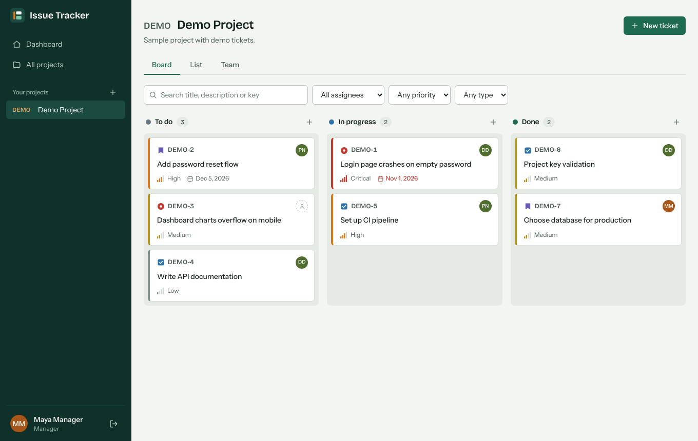
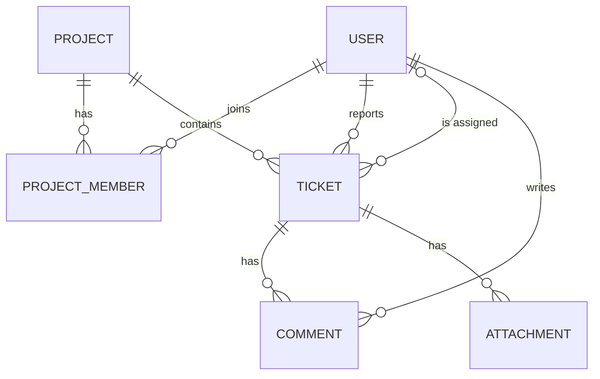
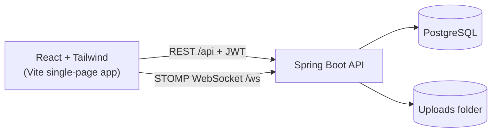
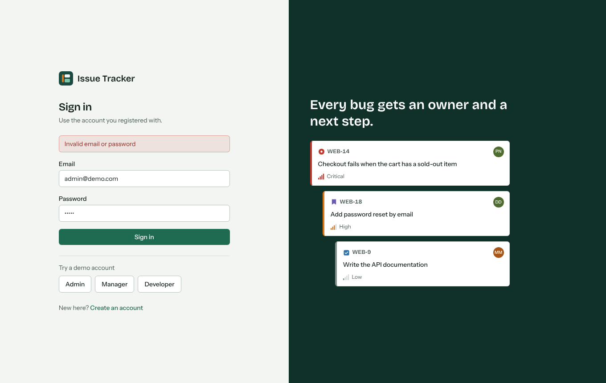
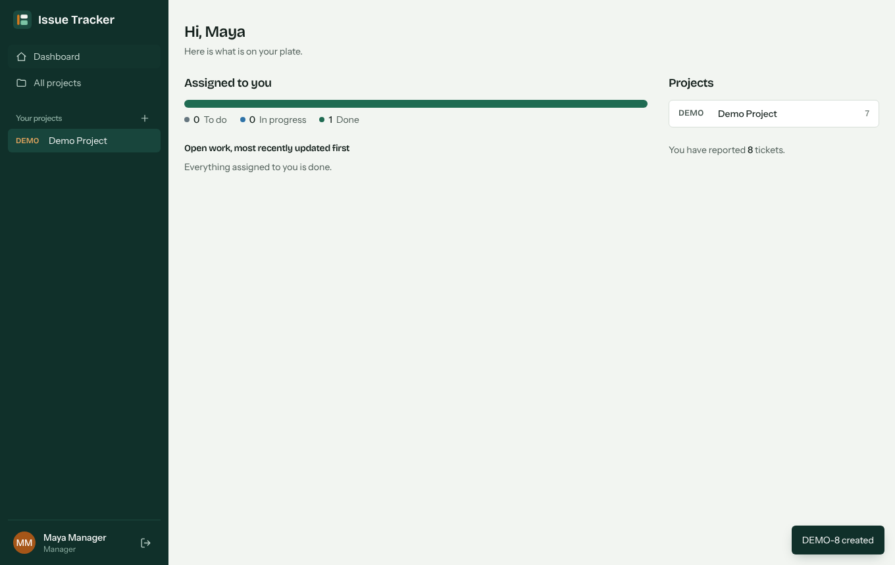
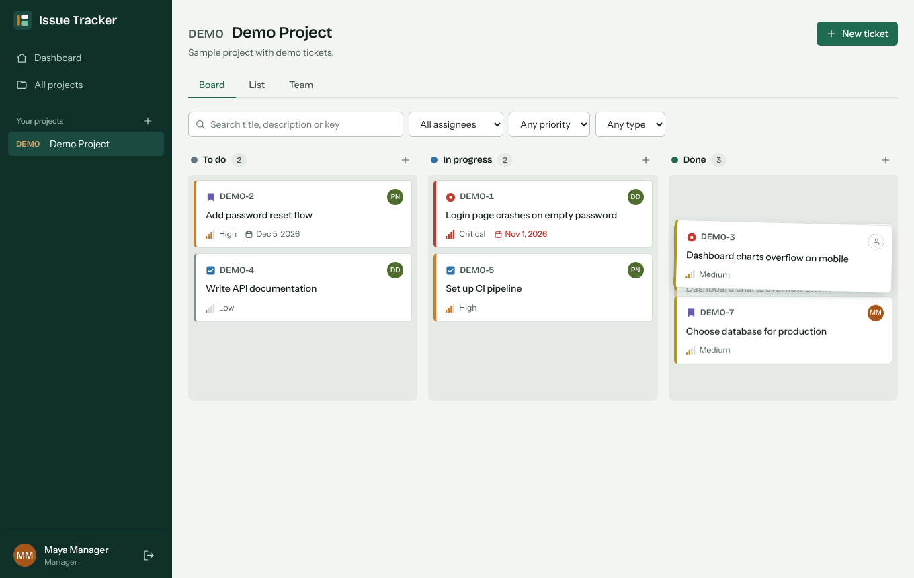
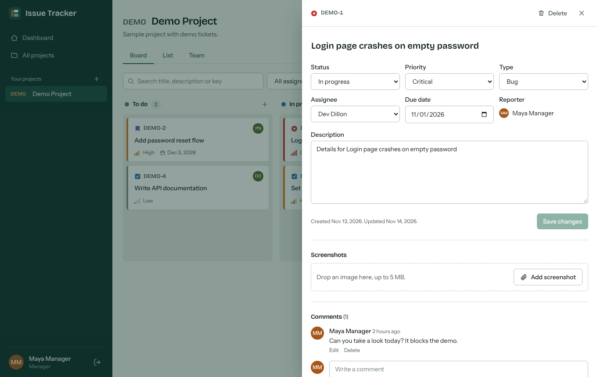
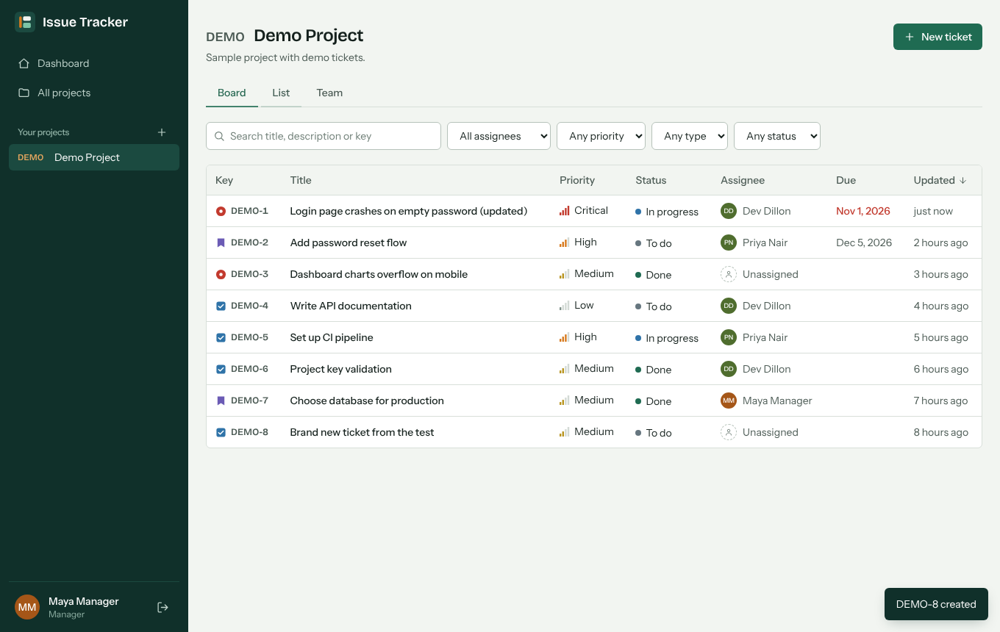
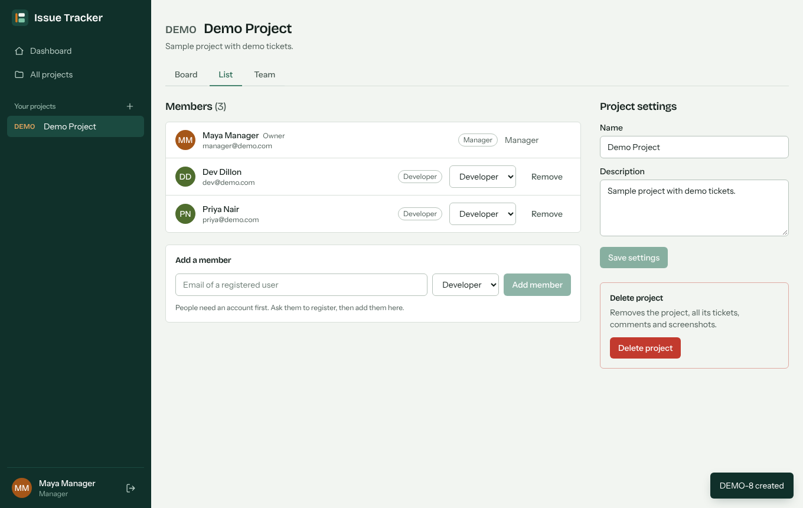
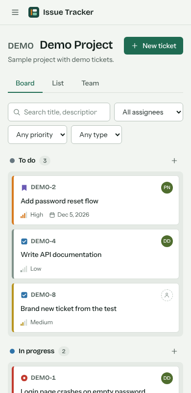

# Issue Tracker
Deploy Link https://issue-tracker-web-usd2.onrender.com

**A Jira-style bug and task tracker built with Spring Boot, React and PostgreSQL.**

     

<!-- Live demo: add your deployed URL here once it is live -->



## Table of contents

1. [Introduction](#1-introduction)
2. [Research](#2-research)
3. [Tech stack and the reasons](#3-tech-stack-and-the-reasons)
4. [The libraries](#4-the-libraries)
5. [Features, with screenshots](#5-features-with-screenshots)
6. [Getting started](#6-getting-started)
7. [Conclusion](#7-conclusion)

---

## 1. Introduction

Software teams lose track of work when bugs and tasks live in chat messages, emails and spreadsheets. Nobody knows who owns a bug, what state it is in, or what was already tried.

**Issue Tracker** solves this in the way tools like Jira do. A team creates a project, adds its members, and files tickets (bugs, tasks or stories). Every ticket has an owner, a priority and a status, and moves across a Kanban board from **To do** to **In progress** to **Done**. People discuss tickets in comments and attach screenshots. Roles decide who is allowed to do what.

It is a full-stack project with a secured REST API (Spring Boot) and a single-page app (React), written to follow how enterprise Java applications are structured: layered code, DTOs, centralised error handling, database relationships, role-based access and a deployable build.

**What you can do with it**

- Register and sign in. Passwords are hashed and sessions use JWT tokens.
- Create projects, add or remove team members, and give each person a role.
- Create, edit, assign and delete tickets with a priority, type and due date.
- Drag tickets across a Kanban board. The order is saved.
- Comment on tickets and attach screenshots.
- Search and filter by text, status, priority, type and assignee.
- See teammates' changes appear live, without refreshing.
- Explore and test every endpoint in Swagger.

---

## 2. Research

### The problem space

Before choosing technology, I looked at how existing tools approach the problem, and what a small team actually needs from one.

| Tool | What it does well | Where it falls short for a small team |
| --- | --- | --- |
| Jira | Very complete: workflows, roles, reports | Heavy to configure; many features a small team never uses |
| Trello | Simple, pleasant boards | Cards are loosely structured; weak ownership, priority and permissions |
| GitHub Issues | Close to the code | Tied to repositories; no board-level roles per project |
| Linear | Fast and focused | Opinionated and closed; not something you can learn the internals from |

**Requirements drawn from this:**

1. A board that is fast and pleasant to use, because that is where people spend their time.
2. Every ticket must have a clear owner, priority and status.
3. Real permissions: not everyone should be able to delete everyone's work.
4. Quick answers to "what is mine?" and "what is urgent?" (a dashboard, search and filters).
5. Changes by one person should show up for the others.
6. Easy to run and deploy (Docker, one config file for the host).

### Technical decisions

Each design question below was researched and decided on purpose.

| Question | Options considered | Decision and reason |
| --- | --- | --- |
| How do users stay signed in? | Server sessions, or JWT | **JWT.** The React app and the API run on different origins, and a stateless token keeps the API simple to scale and deploy. |
| Which database? | MySQL or PostgreSQL | **PostgreSQL.** Strong row-level locking, and managed PostgreSQL is available on most free hosts. The JPA code is portable, so MySQL would also work. |
| Which drag-and-drop library? | `react-beautiful-dnd` or `dnd-kit` | **dnd-kit.** `react-beautiful-dnd` has been deprecated by its maintainers. dnd-kit is maintained, works with React 18, and has built-in keyboard and touch support. |
| How is card order stored? | Renumber the whole column on every move, or store a position per card | **A position per card.** A card dropped between two others gets the midpoint of their positions, so a move updates one row, not the whole column. |
| How do two people create tickets at once without getting the same number? | Max + 1, or a counter on the project | **A counter on the project, read under a database row lock** (`SELECT ... FOR UPDATE`). Numbers like `BUG-12` can never repeat. |
| How does the UI learn about other people's changes? | Polling, or WebSocket | **WebSocket (STOMP).** The server sends only ids after the transaction commits; the client then refetches. No ticket content travels over the socket, and joining a project's channel requires membership. |
| Where do permission checks live? | In the UI, or on the server | **On the server, in one `AccessService`.** The UI hides buttons you cannot use, but that is only a convenience. |
| How does search stay flexible? | One query per filter combination, or a dynamic query | **JPA `Specification`.** The query is built from whichever filters are present, with an entity graph to avoid N+1 queries on list pages. Sort fields are allow-listed. |
| Where do screenshots live? | Database blobs, disk, or object storage | **Disk with random names**, behind an authenticated download endpoint. Type and file signature are checked. Moving to S3 later is a small change. |
| What does the API return on errors? | Default Spring pages | **One JSON shape** (`status`, `error`, `message`, `fieldErrors`) for validation errors, 401, 403, 404, 409 and 413, so the UI can always show a useful message. |

### Data model



`PROJECT_MEMBER` is a join entity, not a plain many-to-many table, because it carries extra data: the person's role inside that project.

---

## 3. Tech stack and the reasons



| Layer | Technology | Why it was chosen |
| --- | --- | --- |
| Language | **Java 17** | Modern long-term-support Java, with records for compact DTOs. The standard language for enterprise back ends. |
| Backend framework | **Spring Boot 3.3** | Production-ready defaults, dependency injection, and a large ecosystem for security, data and WebSocket. |
| Security | **Spring Security + JWT** | Industry standard for protecting an API. Stateless tokens suit a separate frontend. |
| Persistence | **Spring Data JPA + Hibernate** | Maps real relationships (users, projects, tickets) to tables without hand-written SQL, and gives repositories and dynamic queries. |
| Database | **PostgreSQL** (H2 for local dev and tests) | Reliable, with row-level locks. H2 lets anyone run the project without installing a database. |
| Real time | **Spring WebSocket (STOMP)** | Pushes change events to everyone on a project. |
| API docs | **springdoc OpenAPI (Swagger UI)** | Interactive documentation and a test console, generated from the code. |
| Frontend | **React 18 + Vite** | Component model suits boards, drawers and forms. Vite gives a fast dev server and small production builds. |
| Styling | **Tailwind CSS** | Consistent spacing and colour with a custom theme, and no stylesheet sprawl. |
| Drag and drop | **dnd-kit** | Maintained, accessible, and supports mouse, touch and keyboard. |
| HTTP client | **Axios** | Interceptors attach the token to every request and handle expired sessions in one place. |
| Routing | **React Router** | Deep links such as `/projects/1?ticket=12` open a specific ticket. |
| Packaging | **Docker + Docker Compose, nginx** | The whole system starts with one command. nginx serves the built frontend. |
| Deployment | **Render Blueprint** (`render.yaml`) | Creates the database, API and website from one file. |

---

## 4. The libraries

### Backend (Maven)

| Library | Version | What it does in this project |
| --- | --- | --- |
| `spring-boot-starter-web` | 3.3.5 | REST controllers, JSON handling, embedded Tomcat |
| `spring-boot-starter-data-jpa` | 3.3.5 | Repositories, transactions, `Specification` queries. Uses Hibernate 6.5 and HikariCP for connection pooling |
| `spring-boot-starter-security` | 3.3.5 | Filter chain, BCrypt password hashing, method security, CORS |
| `spring-boot-starter-validation` | 3.3.5 | Request validation with annotations such as `@NotBlank`, `@Email`, `@Size` |
| `spring-boot-starter-websocket` | 3.3.5 | STOMP messaging for live updates |
| `spring-boot-starter-actuator` | 3.3.5 | The `/actuator/health` endpoint used by hosting health checks |
| `springdoc-openapi-starter-webmvc-ui` | 2.6.0 | Swagger UI with a bearer-token "Authorize" button |
| `jjwt` (api, impl, jackson) | 0.12.6 | Creating and verifying signed JWTs |
| `postgresql` | 42.7.4 | JDBC driver for PostgreSQL |
| `h2` | managed by Spring Boot | In-memory database for the `dev` profile and tests |
| `spring-boot-starter-test` | 3.3.5 | JUnit 5 and MockMvc for the integration test |

### Frontend (npm)

| Library | Version | What it does in this project |
| --- | --- | --- |
| `react`, `react-dom` | 18.3 | The UI |
| `react-router-dom` | 6.28 | Pages, protected routes, query-string state for open tickets and tabs |
| `axios` | 1.7 | API calls, token attachment, 401 handling |
| `@dnd-kit/core`, `@dnd-kit/sortable`, `@dnd-kit/utilities` | 6.3, 10, 3.2 | Kanban drag and drop across columns, with keyboard and touch sensors |
| `@stomp/stompjs` | 7.0 | WebSocket client for live updates |
| `tailwindcss`, `postcss`, `autoprefixer` | 3.4, 8.4, 10.4 | Styling pipeline |
| `vite`, `@vitejs/plugin-react` | 5.4, 4.3 | Dev server and production build |
| `@fontsource-variable/bricolage-grotesque`, `@fontsource-variable/instrument-sans` | 5.x | Self-hosted fonts, so the app loads no third-party font files |

---

## 5. Features, with screenshots

> The screenshots use the demo data. The demo accounts are listed in [Getting started](#6-getting-started).

### Sign in and register



- Sign in with email and password. A wrong password shows a clear message on the page, as in the screenshot.
- The first account registered on an empty system becomes the **Admin**. Everyone after that starts as a **Developer**.
- If you open a link while signed out (for example a ticket someone sent you), you are sent to sign in first and then taken straight back to it.
- Passwords are hashed with BCrypt. The server returns a signed JWT that the app sends with every request. An expired or invalid token signs the user out.

### Dashboard



- A bar shows your assigned tickets split across **To do**, **In progress** and **Done**.
- Below it is your open work, most recently updated first. Overdue dates turn red, and each row links straight to the ticket.
- The side list shows your projects and how many tickets each has.

### The Kanban board


- Three columns: **To do**, **In progress**, **Done**, each with a ticket count.
- Each ticket is a card. The **coloured left edge shows its priority** (red critical, orange high, gold medium, grey low), so urgent work stands out without reading anything. The icon shows the type (bug, task or story), and the avatar shows the assignee.
- The **+** on a column header creates a ticket directly in that column.
- The search box and the assignee, priority and type filters narrow the board.

### Drag and drop



- Drag a card to another column or to a new place in the same column. The card tilts and the column highlights as a drop target.
- The new status and position are saved immediately, so the order is the same after a reload and for everyone else.
- It also works on a touch screen (press and hold) and from the keyboard (Space to pick up, arrow keys to move, Space to drop).
- If the server rejects a move, the card snaps back and an error message explains why.

### Ticket details, comments and screenshots



Clicking a card opens a panel, and the address bar changes to `?ticket=12`, so the link can be shared.

- **Edit** the title, description, priority, type, assignee and due date, then **Save changes**. People who are not allowed to edit see the fields disabled, but can still change the status and comment.
- **Screenshots:** drag an image into the box or use *Add screenshot*. PNG, JPEG, GIF or WebP, up to 5 MB. Click a thumbnail to view it full size.
- **Comments:** add, edit and delete. You can edit only your own; managers and admins can delete any.
- **Delete** asks for confirmation, then removes the ticket with its comments and files.
- If a teammate changes the ticket while the panel is open, it refreshes, without losing what you were typing.

### List view



- Every ticket in a table, with key, title, priority, status, assignee, due date and last update.
- Click a column heading to sort. Results are **paged on the server**, 15 at a time, so a project with thousands of tickets stays fast.
- It has an extra **status** filter on top of the board filters. Searching by a key such as `DEMO-3` finds that ticket.

### Team and project settings



- See every member with their account role and project role.
- Managers add people by email (with suggestions as they type), change a member's project role, or remove them. Removing someone unassigns their tickets in that project.
- Managers can rename the project or edit its description. Only an admin or the project's owner can delete the whole project.

### Works on a phone



- The sidebar becomes a slide-over menu, and the board columns stack vertically.
- There is no sideways page scrolling at phone widths.

### Roles and permissions

The server enforces every rule below. The UI only hides the buttons you cannot use.

| Action | Who can do it |
| --- | --- |
| Create a project | Admin, Manager |
| Edit a project, manage members | Admin, or a member with the project role Manager |
| Delete a project | Admin, or the project owner |
| See a project and its tickets | Members and admins |
| Create a ticket, comment, upload a screenshot, move a card | Any member |
| Edit ticket details or assign it | Reporter, assignee, project manager, admin |
| Delete a ticket | Reporter, project manager, admin |
| Edit a comment | Its author |
| Delete a comment or screenshot | Its author or uploader, project manager, admin |

### Live updates

Open the same project in two browsers as different users and move a card in one. The other board updates by itself. The server publishes an event after the change is committed, containing only ids, and the other client refetches what it needs.

### API and Swagger

All endpoints except `/api/auth/*` need `Authorization: Bearer <token>`. Open **http://localhost:8080/swagger-ui.html**, log in through `/api/auth/login`, click **Authorize**, and try any endpoint.

| Method and path | Description |
| --- | --- |
| `POST /api/auth/register`, `/api/auth/login` | Returns `{ token, user }` |
| `GET /api/users/me`, `GET /api/users?q=` | Current user, user search |
| `GET /api/admin/users`, `PATCH /api/admin/users/{id}/role` | Admin only |
| `GET/POST /api/projects`, `GET/PUT/DELETE /api/projects/{id}` | Projects |
| `GET/POST /api/projects/{id}/members`, `PATCH/DELETE /api/projects/{id}/members/{userId}` | Team |
| `GET/POST /api/projects/{id}/tickets` | Search (paged, sortable, filterable) and create |
| `GET /api/projects/{id}/board` | Tickets grouped into the three columns, ordered |
| `GET/PUT/DELETE /api/tickets/{id}` | One ticket |
| `PATCH /api/tickets/{id}/status` | Move a card: `{ status, position }` |
| `PATCH /api/tickets/{id}/assignee` | Assign or unassign |
| `GET/POST /api/tickets/{id}/comments`, `PUT/DELETE /api/comments/{id}` | Comments |
| `GET/POST /api/tickets/{id}/attachments`, `GET /api/attachments/{id}/download`, `DELETE /api/attachments/{id}` | Screenshots |
| `GET /api/dashboard` | Your counts and open work |
| WebSocket `/ws`, topic `/topic/projects/{id}` | Live change events |

---

## 6. Getting started

### Option 1: Docker (one command)

```bash
git clone https://github.com/Nithin0248/issue-tracker.git
cd issue-tracker
docker compose up --build
```

Open **http://localhost:3000**. Demo accounts are created on first start:

| Role | Email | Password |
| --- | --- | --- |
| Admin | `admin@demo.com` | `Admin@123` |
| Manager | `manager@demo.com` | `Manager@123` |
| Developer | `dev@demo.com` | `Developer@123` |

### Option 2: Run the two parts yourself

**Backend** (Java 17+ and Maven). The `dev` profile uses an in-memory database, so PostgreSQL is not needed:

```bash
cd backend
mvn spring-boot:run -Dspring-boot.run.profiles=dev
```

To use PostgreSQL, create a database named `issue_tracker` and run without the profile, passing your password:

```bash
# Windows cmd:   set DB_PASSWORD=your-password
# macOS / Linux: export DB_PASSWORD=your-password
mvn spring-boot:run
```

**Frontend** (Node 18+):

```bash
cd frontend
cp .env.example .env      # set VITE_SHOW_DEMO=true to get demo sign-in buttons
npm install
npm run dev
```

Open **http://localhost:5173**. The API runs on **http://localhost:8080**.

### Configuration

| Variable | Default | Purpose |
| --- | --- | --- |
| `DB_HOST`, `DB_PORT`, `DB_NAME`, `DB_USER`, `DB_PASSWORD` | `localhost`, `5432`, `issue_tracker`, `postgres`, `postgres` | PostgreSQL connection |
| `JWT_SECRET` | dev-only value | **Set this in production.** At least 32 characters |
| `JWT_EXPIRATION_MS` | `86400000` (24 hours) | Token lifetime |
| `CORS_ALLOWED_ORIGINS` | `http://localhost:5173,http://localhost:3000` | Frontend URLs allowed to call the API |
| `UPLOAD_DIR` | `./uploads` | Where screenshots are stored |
| `SEED_DEMO_DATA` | `false` | `true` loads demo users and a demo project into an empty database |
| `VITE_API_URL` (frontend) | `http://localhost:8080` | API address baked into the frontend build |

### Tests

```bash
cd backend
mvn test
```

An integration test exercises the main flow against an in-memory database: registration, login, role rules, projects, members, tickets, moving cards, comments, search, and validation and permission errors.

### Deploy

**Render:** push the repository to GitHub, choose **New, then Blueprint**, and select it. `render.yaml` creates the database, API and website. After the first deploy, set `CORS_ALLOWED_ORIGINS` on the API to the website URL and `VITE_API_URL` on the website to the API URL, then redeploy the website.

Before relying on a free deployment, note that:

- Free disks are temporary, so uploaded screenshots are lost on redeploy. Use a persistent volume or S3 for real use.
- Free instances sleep when idle, so the first request after a pause can take about a minute.
- Keep `SEED_DEMO_DATA=false` on any public site, because the demo passwords are published above.

### Project structure

```
issue-tracker/
├── backend/                      Spring Boot API (Maven)
│   └── src/main/java/com/nithin/issuetracker/
│       ├── config/               Security, CORS, WebSocket, OpenAPI, demo data
│       ├── controller/           REST endpoints
│       ├── dto/                  Request and response objects
│       ├── entity/               JPA entities
│       ├── enums/                Roles, statuses, priorities, types
│       ├── event/                Live-update events
│       ├── exception/            Global error handling
│       ├── repository/           Spring Data repositories
│       ├── security/             JWT service and filter
│       └── service/              Business rules and permission checks
├── frontend/                     React app (Vite)
│   └── src/
│       ├── api/                  Axios client and endpoint functions
│       ├── components/           Board, cards, ticket panel, forms, tables
│       ├── context/              Auth, toasts, project list
│       ├── hooks/                Dialogs, debounce, live updates
│       └── pages/                Login, dashboard, projects, project view, users
├── docs/screenshots/             Images used in this README
├── docker-compose.yml            Database + API + frontend
└── render.yaml                   Render deployment blueprint
```

---

## 7. Conclusion

Issue Tracker covers the full path from an idea to a deployable product. It has a secured REST API, a relational data model, role-based permissions that the server enforces, a drag-and-drop Kanban board, comments, file uploads, server-side search and paging, and live updates, all packaged for Docker and Render.

**What building it taught**

- **Enterprise Java design:** splitting code into controllers, services, repositories and DTOs, and keeping permission rules in one place.
- **Authentication and authorisation:** BCrypt, JWT, per-project roles, and why the server, not the UI, must be the one to say no.
- **Real database relationships:** a join entity with its own data, cascade rules, and queries that avoid N+1 problems.
- **Concurrency:** using a row lock so ticket numbers stay unique when two people create tickets at once.
- **Agile Kanban workflow:** what a board needs to feel fast, including ordering that survives a reload.
- **Production concerns:** environment-based configuration, secrets, CORS, health checks and a repeatable deployment.

**Limitations and next steps**

- Move screenshots to S3 or another object store so they survive redeploys.
- Replace Hibernate's automatic schema updates with Flyway migrations.
- Add refresh tokens and password reset by email.
- Add ticket history (who changed what and when), notifications, and labels, sprints or epics.
- Add rate limiting on login, frontend tests, and a GitHub Actions pipeline that builds and tests on every push.

---

## Author

**Yeripilli Nithin** — Java backend and full-stack developer.

- GitHub: [Nithin0248](https://github.com/Nithin0248)
- LinkedIn: [yeripilli-nithin](https://www.linkedin.com/in/yeripilli-nithin-956907261/)
